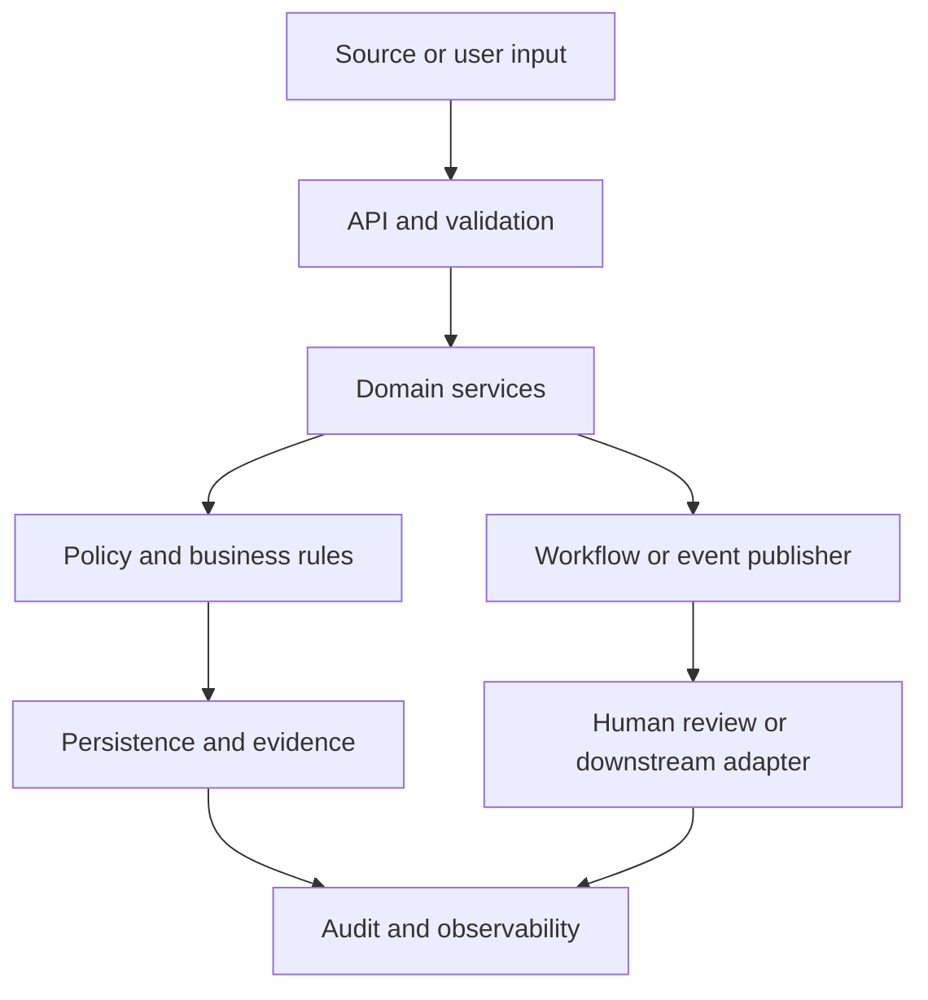

# Document, Page, ExtractedField, ValidationIssue, ReviewTask, ReviewDecision, AuditEvent — Domain Contracts and Data Model

> Proposed contract baseline. These endpoints, event names and entities require implementation and contract-test verification before they are treated as stable interfaces.

## Component interaction

## Project workflow

Submitter -> API intake -> quarantine -> extractor adapter -> evidence/field store -> validator -> review queue -> downstream consumer

## Domain entities

- **POST /v1/documents; GET /v1/documents/{id}; GET /v1/documents/{id}/fields; POST /v1/documents/{id}/validate; POST /v1/documents/{id}/review** — include stable ID, lifecycle status, created/updated timestamps and tenant or domain scope where applicable.

Preserve source keys, raw input references, versioned derived values and decision history. Use explicit foreign keys and uniqueness constraints. Avoid destructive updates to source evidence.

## Proposed REST API

- `DocumentReceived, FieldsExtracted, ValidationCompleted, ReviewRequired, ReviewDecisionRecorded`

Common API rules:
- OpenAPI 3.x schema is the source of truth for request and response shapes.
- Use 201 for created resources, 202 for asynchronous work, 404 for unknown resources, 409 for invalid state transitions and 422 for schema/domain validation errors.
- Include correlation_id in error responses and logs.
- Use idempotency keys for retryable commands; paginate list endpoints.
- Use UTC timestamps and explicit enum values; do not encode workflow state only in free text.

## Proposed domain events

- `Store evidence location for each field; preserve extractor version; low confidence or critical fields require review; never treat extraction score as correctness.` — include event_id, occurred_at, producer, subject, correlation_id and schema_version.

Consumers must be idempotent and tolerate duplicate delivery. Define ordering, replay and schema-compatibility expectations per event stream.

## Business invariants and policy

undefined

## Security and data handling

- Authenticate the caller and authorize access to the specific resource and operation.
- Validate payload size, type, schema and allowed state transitions.
- Store secrets outside the repository; use managed identity or short-lived credentials in deployed environments.
- Encrypt sensitive payloads and redact sensitive fields from logs, traces and error responses.
- Audit administrative actions, policy changes, approvals and data exports.
- Treat uploaded/retrieved content and event payloads as untrusted.
- Use synthetic fixtures in the public repository.

## Contract and data tests

- [ ] OpenAPI schema validation for every request and response.
- [ ] Required/optional fields, enum values, bounds and malformed payloads.
- [ ] Referential integrity and uniqueness constraints.
- [ ] Duplicate command/event and idempotent retry.
- [ ] Invalid state transition returns a stable conflict response.
- [ ] Authorization denial and resource isolation.
- [ ] Event replay preserves business invariants.
- [ ] Audit record links actor, action, resource, timestamp and correlation ID.
- [ ] Sensitive data is absent from logs and sample fixtures.

## Implementation note

This file specifies the intended contracts; it does not assert that these endpoints, events or persistence models are already implemented. Keep the implementation status in the project README aligned with code and test evidence.
