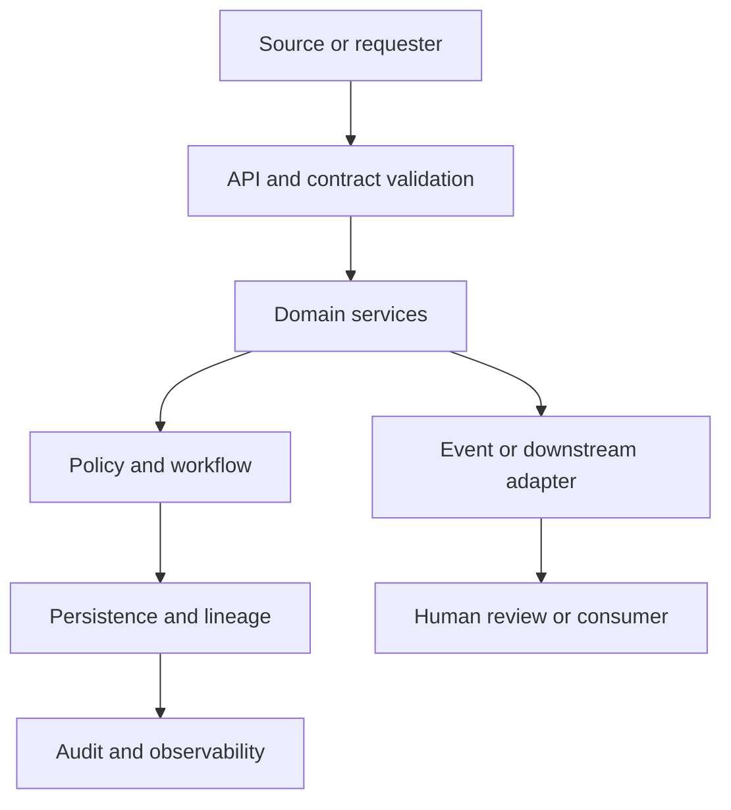

# Party, Organization, SourceRecord, MatchCandidate, GoldenRecord, SurvivorshipRule, StewardDecision, LineageEvent — Domain Contracts and Data Model

> Proposed contract baseline. These endpoints, event names and entities require implementation and contract-test verification before they are treated as stable interfaces.

## Component interaction

## Project workflow

Source adapters -> canonical model -> standardization -> match candidate generation -> match scoring -> steward queue -> survivorship -> golden record publication

## Domain entities

- **POST /v1/source-records; POST /v1/match-jobs; GET /v1/matches/{id}; POST /v1/steward-decisions; GET /v1/golden-records/{id}; GET /v1/lineage/{record_id}** — stable identifier, lifecycle state, timestamps, ownership and source/version references as applicable.

Preserve source keys, raw input references, versioned derived values and decision history. Use explicit relationships and constraints; avoid destructive updates to source evidence.

## Proposed REST API

- `SourceRecordIngested, MatchCandidateCreated, GoldenRecordPublished, StewardDecisionRecorded`

Common API rules:
- OpenAPI 3.x is the source of truth for request and response shapes.
- Use 201 for created resources, 202 for asynchronous work, 404 for unknown resources, 409 for invalid state transitions and 422 for validation errors.
- Include correlation_id in error responses and logs; use idempotency keys for retryable commands.
- Paginate collection endpoints, use UTC timestamps and stable enum values.

## Proposed domain events

- `Keep source identifiers and source values. Make match features/thresholds and survivorship precedence explainable. Ambiguous matches require steward action; merge must be reversible.` — include event_id, occurred_at, producer, subject, correlation_id and schema_version.

Consumers must be idempotent and tolerate duplicate delivery. Define ordering, replay and schema-compatibility expectations per stream.

## Business invariants and policy

undefined

## Security and data handling

- Authenticate callers and authorize each resource/action.
- Validate payload size, schema, state transitions and source authenticity where applicable.
- Store secrets outside the repository; use managed identity or short-lived credentials in deployed environments.
- Encrypt sensitive payloads and redact sensitive fields from logs/traces.
- Audit administrative actions, policy changes, approvals, replay and exports.
- Treat uploaded/retrieved content, tool output and event payloads as untrusted.
- Use synthetic fixtures in the public repository.

## Contract and data tests

- [ ] OpenAPI schema validation for every request and response.
- [ ] Required/optional fields, enum values, bounds and malformed payloads.
- [ ] Referential integrity and uniqueness constraints.
- [ ] Duplicate command/event and idempotent retry.
- [ ] Invalid state transition returns stable conflict response.
- [ ] Authorization denial and resource isolation.
- [ ] Event replay preserves business invariants.
- [ ] Audit links actor, action, resource, timestamp and correlation ID.
- [ ] Sensitive data is absent from logs and sample fixtures.

## Implementation note

This file specifies intended contracts; it does not assert that these endpoints, events or persistence models are implemented. Keep status in README aligned with code and test evidence.
